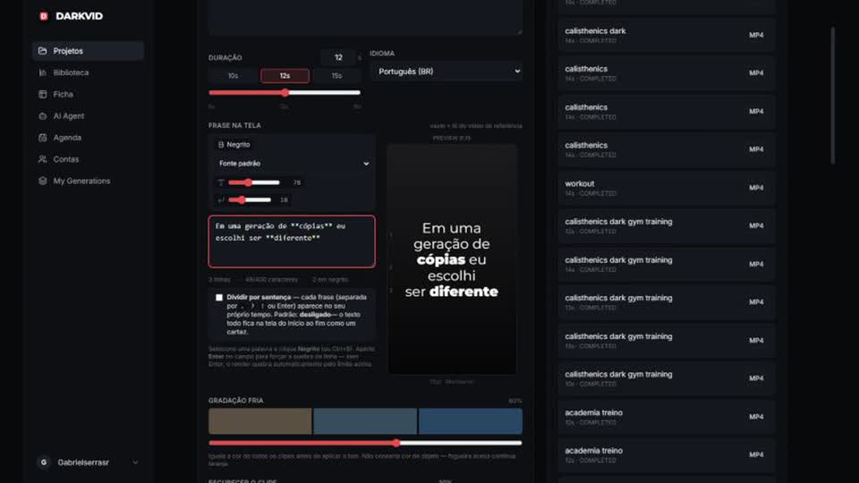
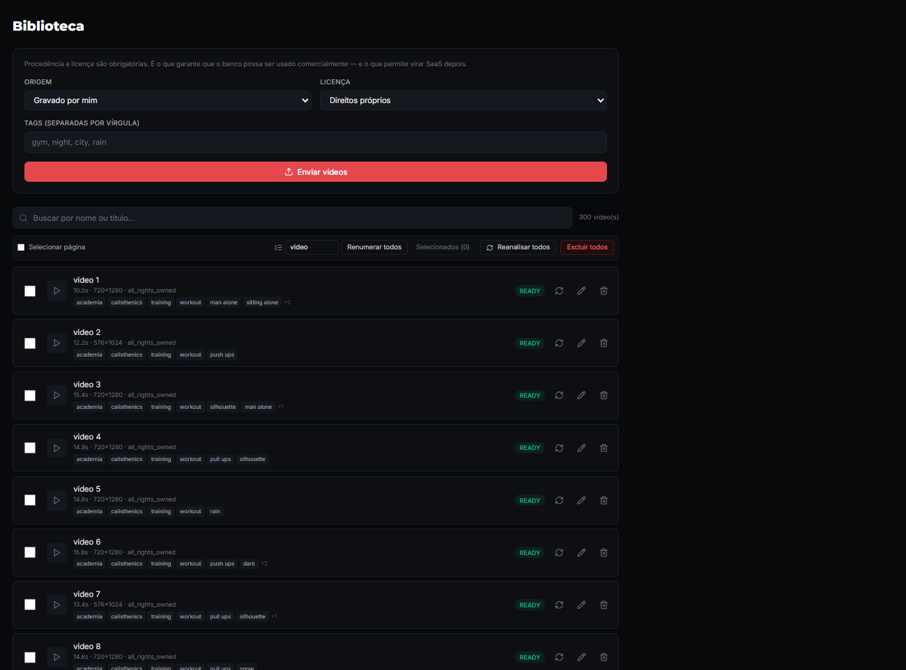
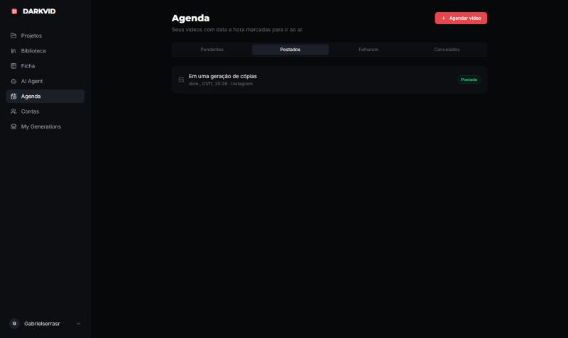
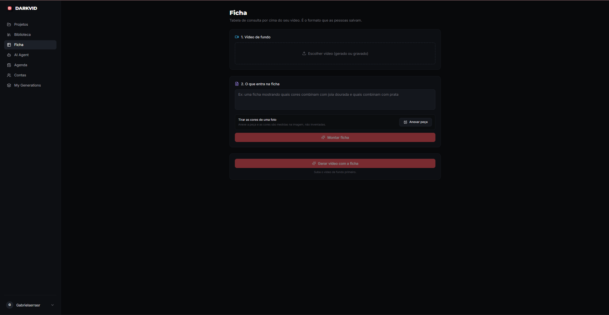

# DarkVid

Plataforma para produzir e agendar vídeos curtos verticais com IA. O código é privado. Este repositório apresenta o produto e a arquitetura.

<table>
  <tr>
    <td><a href="media/video-gerado.mp4"></a></td>
    <td><a href="media/sistema.mp4"></a></td>
  </tr>
  <tr>
    <td>Vídeo gerado (14 s)</td>
    <td>Demonstração do sistema (35 s)</td>
  </tr>
</table>

*Clique nas imagens para assistir.*

## Telas







## O que ele faz

- **Geração de vídeo:** a partir de um prompt e de uma biblioteca de clipes, monta vídeos de 8 a 16 s com frase na tela, música, corte pela batida e gradação de cor unificada
- **Vídeo de referência:** pode seguir o ritmo e os cortes de um vídeo enviado
- **Biblioteca:** registra duração, resolução, FPS, tags, origem e licença de cada clipe
- **Anúncios com persona:** gera roteiro e vídeo de uma persona apresentando o produto, com LTX ou LatentSync
- **Agenda:** conecta contas e agenda publicações

## Decisões de produto

- **Custo visível antes de gastar:** roteiro e imagem base mostram o preço estimado, e a imagem é aprovada antes de liberar a GPU.
- **Produto fiel:** as fotos do produto entram como estão, sem modelo de IA, para manter rótulo e marca.
- **Procedência obrigatória:** cada clipe precisa declarar origem e licença, o que prepara o banco para uso comercial.
- **Motor próprio em vez de API cara:** uma integração com API externa de geração foi descartada por causa do custo, e o pipeline passou a rodar em GPU sob demanda.

## Arquitetura

```
React + React Query + Zustand
        ↓
FastAPI (Pydantic, SQLAlchemy, Alembic)
        ↓
PostgreSQL + pgvector        Redis + RQ (filas de jobs)
        ↓
Modal (GPU sob demanda): LTX, LatentSync, fluxos ComfyUI
        ↓
FFmpeg (montagem) + faster-whisper (transcrição)
```

Os tokens das redes sociais ficam criptografados no banco, e o projeto tem uma suíte de testes automatizados no backend.

## Status

| Parte | Situação |
|---|---|
| Geração e biblioteca | Funcionando |
| Publicação no Instagram | Funcionando |
| TikTok | Conexão funcionando; postagem automática pendente de aprovação da plataforma |
| Ficha (tabela sobre o vídeo) | Em beta |

## Licença

Todos os direitos reservados © Gabriel Serra da Rosa.
